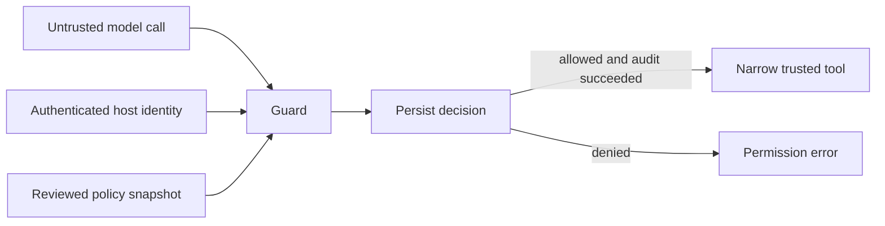

# Agent Permit

**Give AI agents narrow permissions. Enforce them before tools run.**

Agent Permit is a dependency-free Python library and offline CLI for deterministic
AI tool authorization. It places an explicit, default-deny boundary between
model-generated tool calls and trusted application handlers.

An agent may ask to search `customer-secrets`; a policy that permits only
`public-help` refuses that call before the handler executes. The model cannot
supply an `approved` flag or override identity through extra arguments.

## What ships

- Exact tool, principal, tenant, and argument allowlists; no wildcards.
- String limits, integer ranges, strict boolean types, and enumerated values.
- Validated policy snapshots with SHA-256 fingerprints for change tracking.
- An execution wrapper that snapshots arguments, checks permission, and records
  the decision before dispatch. Audit failures block execution.
- Privacy-minimal audit events containing decision metadata, never arguments or results.
- Strict JSON parsing, a 64 KiB document limit, and rejection of duplicate keys.
- Adversarial regression tests, a multi-version GitHub Actions workflow, and an
  executable integration example. No API keys or model downloads required.

**Status:** version 0.1.0, suitable for evaluation and integration review. This is
not an independently audited security product or a complete production platform.
See [deployment requirements](docs/DEPLOYMENT.md) before production use.

## Quick start

Requires Python 3.11 or newer. From the repository root:

```sh
python -m venv .venv
source .venv/bin/activate
python -m pip install .
agent-permit --policy examples/policy.json --request examples/allowed.json \
  --principal support-agent --tenant acme
```

Try the blocked request by changing the request path to `examples/denied.json`.
The CLI returns `0` for allowed, `2` for denied, and `3` for invalid input or policy.
It prints structured JSON and **never executes tools**. CLI identity flags are
operator inputs for testing, not an authentication mechanism.

```sh
python -m unittest discover -s tests -v
python -m examples.integration
```

## Embed the enforcement boundary

```python
from agent_permit import Context, Guard, loads

with open("examples/policy.json") as source:
    guard = Guard(loads(source.read()))

# These values must come from authenticated host session claims.
context = Context(principal="support-agent", tenant="acme")

def search_knowledge(collection, query, limit):
    # Replace with a tenant-scoped, parameterized search adapter.
    return [{"title": "Password reset", "collection": collection}][:limit]

def write_audit(event):
    # Replace with a durable sink; raise if the event cannot be persisted.
    print(event)

result = guard.invoke(
    "search_knowledge",
    {"collection": "public-help", "query": "reset password", "limit": 5},
    context,
    {"search_knowledge": search_knowledge},
    write_audit,
)
```



Use `invoke` for enforcement. `evaluate` is a dry-run decision API; a caller that
ignores its result is not protected. The library does not intercept direct calls
to handlers or provide a sandbox against code running in the same Python process.

## Policy contract

See [examples/policy.json](examples/policy.json). Every listed argument is required;
unknown arguments are denied. Types are scalar only: `string`, `integer`, and
`boolean`. Strings require `max_length` (1–8192); integers require inclusive
`minimum` and `maximum`. Optional `enum` values must themselves satisfy constraints.
Unknown policy fields are rejected to catch typos.

Principal and tenant lists are independent: each listed principal can use the tool
in each listed tenant. For per-principal tenant pairings, construct separate policy
instances after authentication. Tenant identity must also scope the handler's
backend connection; the guard does not automatically inject tenant filters.

Use enumerated **logical resource IDs**, not filesystem paths or arbitrary URLs.
Free-text fields are length checked, not sanitized or classified. A permitted
query may contain hostile instructions; handlers must treat it as data.

## Security scope

The design targets excessive agency and unauthorized tool access, consistent with
[OWASP's Excessive Agency guidance](https://genai.owasp.org/llmrisk/llm062025-excessive-agency/).
It does not detect all prompt injections, moderate content, prevent hallucination,
scan secrets, resolve SSRF, implement human approval, or enforce rate limits.
It performs no network calls and executes no dynamic code.

Read the [threat model](docs/THREAT_MODEL.md), [deployment guide](docs/DEPLOYMENT.md),
and [security reporting policy](SECURITY.md). Contributions: [CONTRIBUTING.md](CONTRIBUTING.md).

## License

MIT. Copyright 2026 Siddharth Tanwar.
